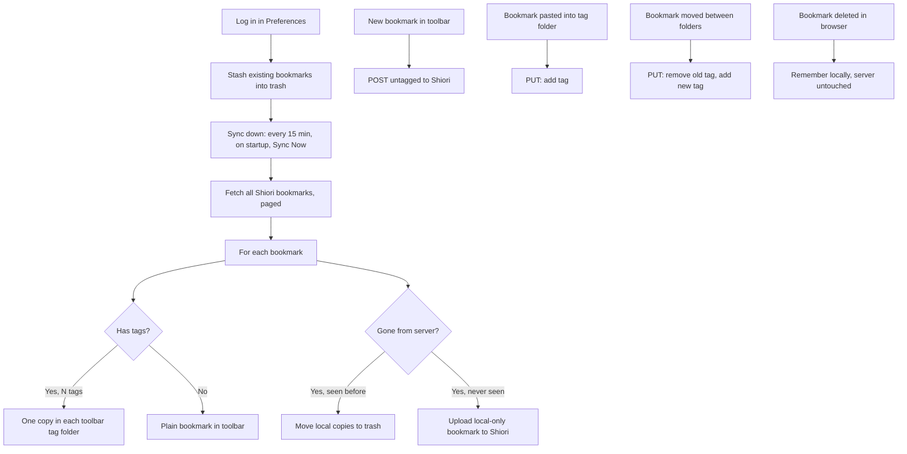

# Shiori Toolbar Sync (Fork)

This fork turns the extension into a background two-way sync between Shiori and native browser bookmarks.
There is no popup management UI anymore.
Your Bookmarks Toolbar is the UI.

## How sync works

On login the extension stashes all existing browser bookmarks into `.Trashed By Shiori Extension`, then syncs everything down from Shiori.
After that it keeps both sides in sync: browser edits push immediately, Shiori edits pull every 15 minutes (plus a Sync Now button).
Browser deletes never delete on the server.
Real deletes happen only in the Shiori portal.
A bookmark deleted in the browser is remembered locally and not recreated.

Tag folders live in the Bookmarks Toolbar.
A bookmark with several tags appears in each folder.
Moving a bookmark between folders retags it on the server.
Only `.Trashed By Shiori Extension` is ignored by sync.
The Preferences page shows sync status, the locally-hidden list (view, unhide, reset), and a full sync log.

---

# Shiori Web Extension (upstream README follows)

Shiori Web Extension is a simple extension for managing bookmarks using Shiori. This extension is intended to integrate Shiori with your favorite web browser. This way, you can save and remove bookmarks in Shiori without switching from your current page.

## Versioning

This project now follows the same versioning system that Shiori uses, that means that starting on `v1.6.0` the extension will match the supported version of the server. This is to avoid confusion and to make it easier to know which version of the extension is compatible with your server.

Different releases for the same server version will be appended as the extension version, for example, `v1.6.0.1` is the first release of the extension for Shiori `v1.6.0`.

## Development Status

This fork targets Firefox only.
Chrome is not supported.

## Initial Setup

Before using the extension, specify the server, username and password in the extension Preferences page, then click LOG IN.
Logging in stashes existing browser bookmarks into trash, then syncs everything down from Shiori.
If all goes well, it will show the currently active session plus sync status, and the Bookmarks Toolbar fills with tag folders.

## License

Shiori Web Extension is distributed using [MIT license](https://choosealicense.com/licenses/mit/), which means you can use and modify it however you want. However, if you make an enhancement for it, if possible, please send a pull request. If you like this project, please consider donating to me either via [PayPal](https://www.paypal.me/RadhiFadlillah) or [Ko-Fi](https://ko-fi.com/radhifadlillah).
